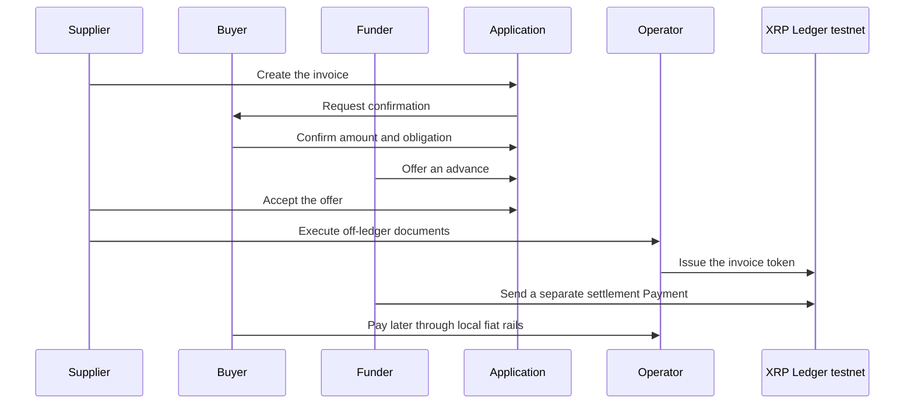

<h1 align="center">🚀 Turn a confirmed invoice into an earlier advance</h1>

<em>TradeNote proposes buyer-confirmed invoice finance for African suppliers, with the record written on the XRP Ledger.</em>

---

  

  
  
  
  
  

  
  
  
  

A supplier uploads an invoice. The named buyer confirms the amount and the obligation. An approved funder offers an advance. After the financing documents, a licensed local operator would record that financing on the XRP Ledger. The full design, sources, and limits are in the [white paper](WHITEPAPER.md). These files are released under the [MIT License](LICENSE).

<em>Version 0.1 · 7 November 2026 · Concept documentation · README, white paper, and MIT licence.</em>

## At a glance

| | |
| --- | --- |
| Proposal | Buyer-confirmed invoice finance for African B2B suppliers |
| Customers | Supplier, named buyer, approved funder, and a licensed local operator |
| Ledger record | One Multi-Purpose Token per financed invoice, written after the legal documents |
| Settlement | A separate Payment of a test-issued settlement token |
| Geography | Pan-African product design, launched through one regulated corridor at a time |
| This repository | Concept documentation, version 0.1, dated 7 November 2026 |

## Contents

- [Problem](#problem)
- [Proposal](#proposal)
- [Customer journey](#customer-journey)
- [Why the XRP Ledger](#why-the-xrp-ledger)
- [Differentiators](#differentiators)
- [Pan-African customers](#pan-african-customers)
- [Review map](#review-map)
- [Team](#team)
- [Implementation status](#implementation-status)
- [Risk management](#risk-management)
- [Prospective roadmap](#prospective-roadmap)
- [Documents](#documents)

## Problem

Many African suppliers deliver on ordinary commercial terms and then wait to be paid. The invoice can be real enough to fund payroll, stock, or transport, while a bank will not advance against it without collateral, audited accounts, or an existing relationship. Informal credit fills that gap at a high price.

Afreximbank has described African SMEs as more than 90% of businesses and over 60% of employment and GDP, with a financing gap estimated at US$300 billion a year. That figure is a broad SME financing gap. In the same 12 December 2025 remarks, African factoring volumes were reported at €21.6 billion in 2017 and €50 billion in 2024, against an argued target of at least €240 billion. IFC and C2FO, on 28 October 2024, described a buyer-accepted invoice model and cited a C2FO estimate of about US$25 billion a year for a national supply-chain-finance platform in Nigeria. The full sourcing, and what those figures do and do not measure, is in the [white paper](WHITEPAPER.md#the-problem).

## Proposal

1. The supplier creates an invoice record and uploads the document.
2. The named buyer confirms the amount and the obligation, or rejects the record. Unconfirmed invoices are not financed. Confirmation is a commercial acceptance, not a payment.
3. An approved funder offers an advance below face value. The offer is priced for credit, time, and operating cost.
4. If the supplier accepts, the parties execute financing or assignment documents off the ledger.
5. After that legal gate, the operator records a Multi-Purpose Token for that invoice, and the funder sends a separate Payment of a test-issued settlement token. The two ledger steps are sequential. They are not an atomic exchange of the invoice token for the settlement token.
6. Collection uses local fiat rails in a later phase. When repayment is complete, the design retires the invoice token.

## Customer journey

Each role sees only its own decision: invoice, confirm, offer, advance, collect. The buyer can confirm from a short link. The screen is specified as an invoice tool for a phone on a weak connection, with status written in words.

## Why the XRP Ledger

The application database holds documents, identity data, and workflow state. The XRP Ledger is added for one job: after the parties are legally bound, a reviewer can inspect what was issued and what was paid without relying on a single administrator to present that record.

The chosen primitives are issuance and direct payment of Multi-Purpose Tokens. Each financed invoice is its own token, held by the approved funder. Settlement is a second, sequential Payment in a test-issued token created for the demonstration. Official documentation describes those issuance and payment features as available. Trading, escrow-based swaps, and confidential transfers are outside this design. The network is a public ledger. Ripple is a separate company, and the test settlement token is not RLUSD.

## Differentiators

- **Buyer confirmation before any advance is booked.** The named buyer accepts the amount and the obligation, which is the same economic logic as buyer-accepted invoice finance.
- **A public record after the legal documents.** The token is an inspectable record of a financing that the contracts have already created.
- **A corridor operator, not a continental licence.** Identity checks, issuance, and collection sit with a licensed local partner. Currency, contracts, and payout rails are adapters.

These are design choices. They are not measured win-rates or customer counts.

## Pan-African customers

The primary customer is an African supplier that invoices another business and needs cash before the due date. The buyer already owes that invoice and can confirm or reject it. The funder is approved in advance and chooses which confirmed invoices to offer against. The operator holds the corridor permissions, issues the tokens, and coordinates collection.

The product language is pan-African. A first launch would still be one corridor, chosen after counsel reviews assignment, notification, factoring or lending rules, payments licensing, and virtual-asset rules. Expansion repeats that work. M-Pesa, MTN MoMo, Airtel Money, Orange Money, Flutterwave, and Paystack are examples of rails a later adapter might use. Naming them does not create an integration or a partnership.

## Review map

The materials are arranged for three readings. The labels describe the documents. They are not a score.

| Reading | What the proposal specifies | Where |
| --- | --- | --- |
| Product design | Phone-first invoice workflow, role-specific actions, confirmation by link, low-bandwidth and accessible screens | [Product design](WHITEPAPER.md#product-design) |
| Technical design | Legal gate, invoice Multi-Purpose Token, sequential settlement Payment, hashes, signing, and reconcile rules | [Technical architecture](WHITEPAPER.md#technical-architecture) |
| Business design | Origination fee, disclosed funder charge, corridor launch, and the sourced market context | [Business model](WHITEPAPER.md#business-model) and [Market position](WHITEPAPER.md#market-position) |

## Team

These are assigned responsibilities for the concept. They are not completed deliverables, and no interface has been shipped.

**UI/UX Lead — [kayode96-max](https://github.com/kayode96-max)**

- User journeys and information architecture for the supplier, buyer, funder, and operator
- Wireframes and interactive prototypes
- Visual design and a reusable design system
- Responsive, accessible interface design
- Usability testing and developer handoff

## Implementation status

Version 0.1 is concept documentation dated 7 November 2026. The repository contains this overview, the white paper, and the licence.

No application, deployment, demo, user base, licence, collection operation, partner integration, signed counterparty, or XRP Ledger transaction history is included. Local payout rails are proposed adapters. The prospective roadmap below is a sequence of work. Phases after this paper are not built, staffed, or dated. Measures in the white paper are targets for a later evaluation, not observed results.

## Risk management

The design treats credit, fraud, legal effect, currency, and settlement assets as operating questions, with the detail and qualitative ratings in [Risk management](WHITEPAPER.md#risk-management).

A buyer can confirm an invoice and later delay, dispute, or default. Approved funders underwrite that buyer. The contract states whether the supplier has to repay the advance. Confirmation does not prove that goods were delivered.

A token records the financing when valid documents say so. It does not, by itself, assign the receivable, perfect a security interest, or replace notice or registration where local law requires them. Inside TradeNote, a canonical key and a document hash can refuse a second financing of the same invoice. A bank or another platform is outside that view.

If a local-currency invoice is later funded in another currency, including a dollar stablecoin, the exchange rate can move before the buyer pays. The first demonstration uses a test-issued settlement token, not RLUSD. A real stablecoin would add issuer, reserve, redemption, and ramp questions that the test token does not have. There is no TradeNote platform token and no guaranteed yield.

## Prospective roadmap

The phases are an order of work, not a delivery calendar.

1. **Concept** — This documentation, including the [white paper](WHITEPAPER.md).
2. **Narrow demo** — A reviewer walkthrough of the three commercial roles on testnet, with one invoice token and a separate settlement Payment.
3. **Corridor design** — Legal templates, uniqueness rules, and issuer-key design for one regulated corridor.
4. **Supervised pilot** — A small test with a licensed partner in one corridor.
5. **More corridors** — Repeat the operator and adapter pattern, corridor by corridor.

## Documents

- [WHITEPAPER.md](WHITEPAPER.md) — Version 0.1 white paper
- [LICENSE](LICENSE) — MIT License
