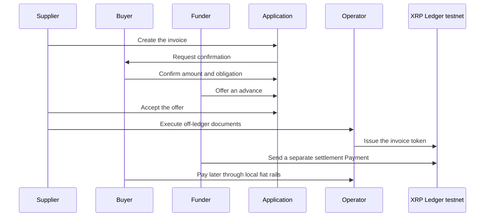
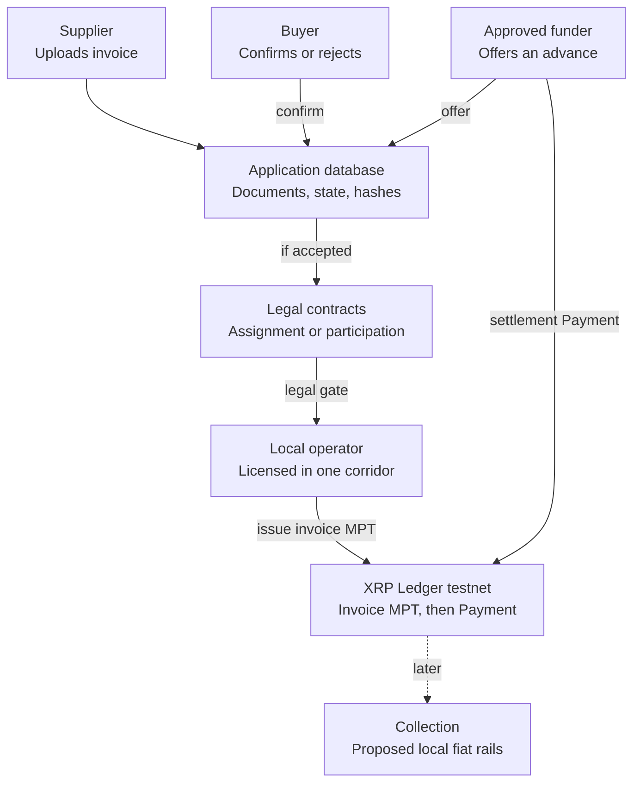

# TradeNote White Paper

Buyer-confirmed invoice finance for African suppliers, with a proposed XRP Ledger record written after the legal documents.

**Version 0.1** · Concept and proposed architecture · 7 November 2026, Africa/Lagos

Related files: [README.md](README.md) · [docs/ARCHITECTURE.md](docs/ARCHITECTURE.md) · [LICENSE](LICENSE)

## Contents

- [Executive summary](#executive-summary)
- [Implementation status](#implementation-status)
- [The problem](#the-problem)
- [Customers and the pan-African path](#customers-and-the-pan-african-path)
- [Solution and customer journey](#solution-and-customer-journey)
- [Product design](#product-design)
- [Legal model and invoice lifecycle](#legal-model-and-invoice-lifecycle)
- [Why the XRP Ledger](#why-the-xrp-ledger)
- [Technical architecture](#technical-architecture)
- [Business model](#business-model)
- [Market position](#market-position)
- [Risk management](#risk-management)
- [Prospective roadmap](#prospective-roadmap)
- [Measures for a later build](#measures-for-a-later-build)
- [Open questions](#open-questions)
- [Conclusion](#conclusion)
- [Sources](#sources)

## Executive summary

TradeNote proposes buyer-confirmed invoice finance for African suppliers who have delivered to another business and are waiting to be paid. This paper, version 0.1 dated 7 November 2026, sets out the concept, the customer journey, the ledger design, and the business model. [Implementation status](#implementation-status) records what this repository contains today.

A supplier uploads an invoice. The named buyer confirms the amount and the obligation. An approved funder offers an advance below face value. The parties execute financing or assignment documents off the ledger. Only then does the operator record a Multi-Purpose Token for that invoice, and the funder send a separate Payment of a test-issued settlement token. The two ledger steps are sequential. Written contracts create any legal assignment of, or participation in, the receivable. The token is the shared record of that financing.

The commercial idea is already used by institutions that finance invoices a buyer has accepted. TradeNote's design choices are a hard confirmation gate, an inspectable ledger record after the documents are signed, and a licensed operator in each corridor. A licensed local partner would handle corridor-specific compliance, token issuance, and collection. Local mobile-money and payment-processor payouts are proposed adapters for a later phase.

## Implementation status

This version is concept documentation. It describes a proposed design. The repository holds this paper, the README, the architecture document, and the MIT licence.

No application, deployment, demo, team roster, partner list, licence, user count, collection operation, or XRP Ledger transaction is included, and none is invented here. There are no signed funders, operators, buyers, or suppliers. No team roster was provided. A test-issued settlement token does not demonstrate fiat settlement finality. Feature dates below are taken from public documentation retrieved on 7 November 2026, Africa/Lagos. A later build still has to confirm those features on the testnet it uses.

The [prospective roadmap](#prospective-roadmap) is a sequence of work, not a calendar and not a list of shipped functions. The current phase is this paper. Later phases are not built. The [measures for a later build](#measures-for-a-later-build) are targets. No benchmark has been run.

## The problem

Many African suppliers deliver goods or services on ordinary commercial terms and then wait through long buyer payment cycles. The invoice is real enough to run payroll, restock, or pay transport, but banks and other formal lenders often will not advance against it without collateral, audited accounts, or a relationship the supplier does not have. Informal credit can fill the gap at a high price and with little transparency. The result is a working-capital shortage among firms that already have customers, not an absence of economic activity.

The economic problem is timing and access. Afreximbank has said that African SMEs account for more than 90% of businesses and over 60% of employment and GDP, and that they face a financing gap estimated at US$300 billion a year. That figure is a broad SME financing gap. It is a different measure from a trade-finance gap, and it is not TradeNote's market size. In the same remarks, Afreximbank reported that African factoring volumes rose from €21.6 billion in 2017 to €50 billion in 2024, while arguing that volumes should reach at least €240 billion, about 10% of continental GDP, to support SME-led transformation. Factoring and related invoice finance convert receivables into earlier cash. They are one response to long buyer payment cycles, not a cure for every form of SME credit need.

The same Afreximbank remarks, delivered in Abidjan on 12 December 2025, also noted nearly 200 factoring companies on the continent and quoted a central-bank advisor on long payment delays and collection challenges. This paper keeps the US$300 billion SME financing gap distinct from the factoring-volume gap against the €240 billion target. It does not relabel either number as Africa's trade-finance gap, a term usually applied to instruments such as letters of credit and guarantees.

IFC, in a 28 October 2024 announcement with C2FO, described micro, small, and medium enterprises as accounting for up to 90% of businesses and 80% of jobs across Africa, while struggling to obtain working capital through the traditional financial system. That announcement also cited a C2FO estimate that a national supply-chain-finance platform in Nigeria could unlock around US$25 billion a year in financing for MSMEs. The figure shows that invoice-based working capital can be large in a single African market. It is not a revenue projection for TradeNote, and it does not make TradeNote a one-country product. The same announcement described a model in which institutions finance discounted invoices that buyers have accepted for payment, allowing suppliers to lean on the buyer's credit rather than on their own collateral. TradeNote's buyer-confirmation gate follows that economic logic. It does not imply a relationship with IFC or C2FO.

## Customers and the pan-African path

TradeNote's primary customer is an African B2B supplier that invoices another business and needs cash before the due date. The second participant is the named buyer, who already owes the invoice and can confirm or reject the amount and the obligation. The third participant is an approved funder that may advance a discounted amount if it accepts the credit of that buyer. The fourth participant is a licensed local partner, or operator, that would run know-your-customer and anti-money-laundering checks, hold relevant permissions in one corridor, issue the ledger tokens, and coordinate collection.

The product language and architecture are pan-African. The application can treat currency, identity checks, contract templates, and payout rails as adapters. The first real launch would start in one corridor where invoicing practice, assignment law, payments licensing, lending or factoring rules, and virtual-asset rules can be followed. Expansion repeats that work, corridor by corridor, rather than copying the first licence across borders. AfCFTA and related trade-facilitation efforts may improve the commercial backdrop over time. They do not replace national licensing.

The first corridor should be chosen only after counsel reviews how receivables are assigned or charged, how buyers must be notified, whether invoice finance is regulated as lending or factoring, and how virtual assets and payments are licensed. Mobile-money networks such as M-Pesa, MTN MoMo, Airtel Money, and Orange Money, and processors such as Flutterwave or Paystack, are examples of rails a corridor adapter might later use. Naming them is not an integration and not a partnership.

TradeNote is aimed at confirmed business invoices, approved funders, and a licensed operator. Consumer invoices, anonymous invoice marketplaces, and unscreened public lending are outside the design. Funders choose which confirmed invoices to offer against, and they take credit and collection risk under their own contracts.

## Solution and customer journey

TradeNote is a three-party commercial workflow with a four-party operating model. The supplier creates an invoice record and uploads the document. The buyer reviews the same record and confirms that the amount and the obligation are correct, or rejects them. Unconfirmed invoices cannot be financed. An approved funder may then offer an advance below face value. If the supplier accepts, the parties execute the corridor's financing or assignment documents outside the ledger. After that legal gate, the operator submits the on-ledger record and the funder sends a separate settlement payment, using test-issued assets in any first demonstration.

### Proposed steps

1. **Supplier creates the invoice record.** Enters buyer, amount, currency, and due date, and uploads the document. This step stays in the application database.
2. **Buyer confirms or rejects.** The named buyer confirms the amount and that the obligation exists, or rejects the record. Confirmation is not payment.
3. **Approved funder offers an advance.** A pre-approved funder proposes an amount below face value. This is an offer, with the funder's charge disclosed in the offer and the contract.
4. **Supplier accepts and documents are executed.** Commercial acceptance is paired with off-ledger contracts. The ledger is not written until that legal gate is marked complete.
5. **Operator records the invoice token.** The operator creates a Multi-Purpose Token issuance for that financed invoice and pays it to the authorized funder. This is a record of the financing the documents describe.
6. **Funder sends a separate settlement payment.** The funder pays the supplier with a test-issued settlement token in a second transaction. If that payment fails, the application reconciles the file. The two transactions are sequential.
7. **Buyer pays and the file is closed.** Collection happens through local fiat rails proposed for a later phase. The ledger can retire the invoice token after repayment.

### Customer journey



### Architecture flow



## Product design

The interface is specified as an invoice tool. Screens use ordinary words: invoice, confirm, offer, advance, and collect. Each role sees only the actions that role can take. Status after every step is written in words, not communicated by colour alone. Buttons and form fields are large enough for a phone thumb. Forms ask for one decision at a time, save a draft when the network drops, and avoid heavy media. Image uploads are compressed. Buyer confirmation works from a short link sent by SMS or email, so the buyer does not have to search for the invoice.

Accessibility and low bandwidth are part of the specification. The interface keeps strong contrast, visible labels, and error text that names the field and the repair. It does not rely on gesture-only controls or on colour as the only status signal. Pages remain usable on a modest Android phone over an unstable connection. A first demonstration can use seeded sample accounts so a reviewer is not asked for identity documents or wallet secrets.

These are design requirements for a first product. They have not been built or tested. A reviewer walkthrough is phase 1 of the [prospective roadmap](#prospective-roadmap).

| Choice | Specification |
| --- | --- |
| Task language | Invoice, confirm, offer, advance, collect |
| Role views | Each participant sees only the actions that role can take |
| Status | Written in words, with colour as a secondary cue |
| Buyer entry | Short link by SMS or email |
| Weak networks | Draft save, compressed uploads, modest Android layout |
| Accessibility | Contrast, visible labels, errors that name the field and the repair |
| Reviewer path | Seeded sample accounts, with no identity documents or wallet secrets requested |

## Legal model and invoice lifecycle

The asset in TradeNote is a receivable: a contractual right to be paid a stated amount by a named buyer on or after a due date. A ledger token can record that the parties took certain steps. It cannot, by itself, assign that receivable under local law, create a perfected security interest, or replace notice to the buyer or registration in a receivables registry where the law requires those acts. The design uses a narrower statement. If valid legal documents say so, the token stands as an on-chain record of a contractual assignment or of a funder's participation in that receivable. If those documents are missing, invalid, or silent, the token is a database row on a public ledger.

Buyer confirmation is a commercial statement that the amount and the obligation are accepted by the named buyer at that moment. It matters because invoice fraud and disputes often start with invoices the buyer never agreed were due. It is not a promise that the buyer will pay on time, will not later dispute quality or delivery, or will not become insolvent. Goods-delivery evidence stays off-chain, in delivery notes or the buyer's own confirmation. An uploaded PDF is not proof of shipment.

Duplicate financing is a structural limit. Inside TradeNote, the application would build a canonical invoice key from the buyer's legal-entity identifier, the supplier's identifier, the invoice number, the issue date, the currency, and the normalized amount. It would store a SHA-256 hash of a canonical document package and refuse a second financing that matches that key or hash. That hash, not the document itself, is what would be written into on-chain metadata. The ledger and the application cannot see a bank, another factor, or another platform that finances the same invoice under a different reference. Mitigations are legal and operational: warranties from the supplier, notice to the buyer that payment should be made only to the collection account, and, where a public registry exists, registration of the assignment. A buyer could still confirm the same invoice in two places. Funders underwrite that residual risk.

Personal and commercially sensitive documents stay off the ledger. Invoice files, identity documents, addresses, bank details, and underwriting notes belong in an access-controlled application database, encrypted at rest in any later production design. On-chain metadata should carry an opaque invoice reference, the document hash, a currency code, and similar non-personal fields, using the conventional Multi-Purpose Token metadata shape, which official documentation limits to 1024 bytes. Amounts visible as token quantity are a privacy trade-off: they help an auditor inspect the record and they also reveal commercial values to anyone who can read the ledger. This design accepts that trade-off for financed invoices and keeps names and documents off the ledger.

Collections, defaults, and disputes are off-chain processes with optional on-chain marks. The buyer pays through the corridor's fiat rails into an account controlled under the financing contract. If the buyer pays, the operator reconciles the collection, the funder is repaid according to the contract, any residual returns to the supplier, and the invoice token is sent back to the issuer, which burns it. If the buyer disputes, the operator can lock the invoice token so its balance cannot move except back to the issuer, and the file moves into a dispute state while people examine the claim. If the buyer defaults, the outcome depends on whether the contract is written with recourse to the supplier or without it. This paper does not choose that term for every corridor. In a non-recourse illustration the funder bears buyer-credit risk after taking its own underwriting decision. In a recourse illustration the supplier may have to repay the advance. Neither version is a guaranteed recovery, and neither is implemented.

### Invoice lifecycle states

| State | Meaning | Ledger write |
| --- | --- | --- |
| Draft | Supplier is preparing the record | None |
| Awaiting buyer | Sent to the named buyer | None |
| Rejected | Buyer disputes amount or obligation | None |
| Confirmed | Buyer accepted amount and obligation | None |
| Offered | An approved funder proposed an advance | None |
| Accepted | Supplier accepted commercially | None |
| Legally bound | Financing or assignment documents executed | None. This state is the gate before any ledger write. |
| Recording | Operator is submitting ledger transactions | In flight |
| Recorded | Invoice token issued and held by the funder | Issuance, holder authorization, Payment to funder |
| Advanced | Settlement Payment to the supplier succeeded | Separate Payment of the test settlement token |
| Needs reconcile | Invoice token exists but settlement Payment failed | Retry or reverse according to an operator runbook |
| Disputed | A party contests the file after financing | Optional lock of the invoice token |
| Collecting | Awaiting the buyer's fiat payment | None required |
| Settled | Funder repaid and residual handled | Invoice token returned to the issuer and burned |
| Defaulted | Buyer did not pay as required | Optional lock; recovery happens off-chain |
| Cancelled | Withdrawn before financing | None if no token was issued |

## Why the XRP Ledger

A conventional database can run this workflow, store documents, and enforce role permissions. In several respects it is the better tool: it can be private, it can be changed when a court orders a correction, and it can hold files that must never be published. TradeNote therefore keeps documents, identity data, underwriting notes, messages, and workflow state in an application database. The case for also using a public ledger is a shared record of the financing, not a decision to publish the invoice file.

After the parties are legally bound, they need a record of what was issued and what was paid that no single application administrator can quietly rewrite. The XRP Ledger can provide that shared record as transaction hashes and token balances that a reviewer can open in a public testnet explorer without logging into TradeNote. Independent inspectability is the reason to write anything on-chain. Timestamping, allow-listed holders, and a burned token at settlement are useful secondary properties. They sit alongside law, know-your-customer checks, and collection.

The network in this design is the XRP Ledger, a public blockchain with its own documented transaction types. Ripple is a separate company. Ripple USD, or RLUSD, is Ripple's stablecoin. Official Ripple documentation describes RLUSD as issued natively on the XRP Ledger and as an ERC-20 token on several EVM networks, with real-world value and reserves on mainnet and no financial value on testnet. TradeNote's first demonstration uses a test-issued settlement token created by the operator and labelled as a stand-in. Using the XRP Ledger is not a Ripple partnership and does not imply access to Ripple's reserves, licences, or customers.

## Technical architecture

The architecture below is the proposed build. Feature status is taken from official xrpl.org pages retrieved on 7 November 2026, Africa/Lagos. Availability must still be validated on the specific testnet used for any later build, because networks do not always match documentation at the same moment.

Official documentation prefers Multi-Purpose Tokens for most new tokens. Issuing and direct payments were added by the MPTokensV1 amendment and are documented as enabled on 1 October 2025. Each issuance can have its own flags, on-chain metadata, and an optional supply cap. An issuer cannot hold its own tokens; sending units back to the issuer burns them. A holder must first submit `MPTokenAuthorize` to opt in. If Require Auth is enabled, the issuer must then approve that holder before a Payment can succeed. MPT use in the decentralized exchange, cross-currency payments, and automated market makers remains a proposed standard and is not implemented. This design does not trade invoice tokens and does not depend on a native MPT DEX.

The chosen representation is exact. Each financed invoice becomes its own Multi-Purpose Token issuance after the legally bound state. The token quantity equals the invoice face amount in minor units, so an explorer can see the recorded value. Flags would be set at `MPTokenIssuanceCreate` and would not depend on later mutation: Require Auth on, so only approved accounts can hold the token; Can Transfer off, so the holder can send it only back to the issuer; Can Lock on, so the operator can freeze movement during a dispute; and Can Clawback on, so the operator can reverse a holder balance if keys are lost or a documented error occurs. Can Trade is irrelevant because MPT DEX trading is not implemented. Can Escrow is left off. Official documentation describes the TokenEscrow amendment as enabled on 12 February 2026, and states that an MPT can be escrowed only if both Can Escrow and Can Transfer are enabled. TradeNote's invoice token is intentionally non-transferable, so it cannot use that escrow path. Even if escrow were enabled on a transferable token, it would lock one asset until a time or a PREIMAGE-SHA-256 condition was met. That is not an atomic swap of an invoice token for a settlement token, and this paper does not call it delivery-versus-payment.

Metadata would follow the documented convention for Multi-Purpose Tokens, including `asset_class` of `rwa` and `asset_subclass` of `private_credit`, which the documentation defines as tokens representing debt obligations such as loans, invoices, or receivables. The metadata would also carry an opaque invoice reference and the SHA-256 hash of the off-chain package. It would not carry personal names, identity numbers, or documents. Mutable metadata and flag changes after issuance are described as requiring the DynamicMPT amendment, which documentation retrieved for this paper still listed as open for voting. The design therefore sets what it needs at creation time.

Settlement uses a second token: a test-issued Multi-Purpose Token created by the operator, labelled as a stand-in, with Require Auth on and Can Transfer on so an authorized funder can pay an authorized supplier. The issuer mints by sending a Payment to the funder's authorized account, because the issuer cannot hold its own token. The funder then sends a separate Payment to the supplier. If the invoice-token Payment succeeds and the settlement Payment fails, the file enters needs reconcile. The operator runbook would retry the settlement Payment or reverse the invoice token by return or clawback. Those are sequential transactions with operational recovery, not a single atomic exchange.

Credentials, documented as enabled on 4 September 2025, can attest that an account completed an off-chain approval without publishing the underlying documents. They are a later option for marking approved participants, not part of the first demonstration. Lending protocols, single-asset vaults, confidential transfers, and any platform-wide speculative token are out of scope. TradeNote does not need its own economic token.

| Primitive | Role in this design | Needs validation |
| --- | --- | --- |
| Application database | Documents, personal data, workflow, underwriting, hash index | Access control and encryption in any later build |
| One invoice MPT per financed invoice | Public record held by the funder after the legal gate | Create, authorize, Payment, burn, lock, and clawback on the chosen testnet |
| Test settlement MPT | Stand-in asset for the funder-to-supplier Payment | Mint to funder, then Payment to supplier; not RLUSD |
| SHA-256 document hash | Link the public token to the private file without publishing the file | Canonicalization so the same package always hashes the same way |
| External wallet signing | Each party signs its own transactions; the app never asks for a seed phrase | Demo accounts or an external signer against testnet |
| Operator issuer keys | A disclosed custody point for issuance, lock, and clawback | Key storage, ideally multi-sign in a later phase |

The signing model for a first demonstration is explicit. The application must never collect seed phrases, wallet passwords, or private keys. The intended long-term model is that each supplier, buyer, and funder signs with a wallet they control, against testnet in the first phase. The operator holds issuer keys, and possibly a separate operational account if one is needed for workflows that the issuer account cannot perform because issuers cannot hold their own tokens. Compromise of those issuer keys could mint, lock, or claw back tokens, so that custody is a first-class risk, not an implementation detail. A scripted demonstration may use pre-funded, clearly labelled demo accounts. It should still keep secrets out of the product interface.

Reliability controls belong in the application even when the ledger is honest. State transitions should be idempotent. A file should not be marked recorded or advanced until the relevant transaction has a validated testnet result and a stored hash. Partial completion must raise a reconcile item rather than silently showing success. Buyer confirmation links should expire and should not be replayable into a second confirmation by a stranger. Document hashes should be recomputed before any later audit export. Off-chain files should be backed up. None of these controls have been implemented here; they are part of the design that a later build would owe its users.

## Business model

TradeNote would earn a platform fee for originating and administering a financed invoice. The proposed shape is an origination fee paid by the supplier and taken from the advance, optionally plus a small collection or administration charge at settlement. The funder's compensation is a separately disclosed finance charge set in the offer and in the contract. That charge is payment for credit risk, time, and operating cost. It is not a promised yield, and it is not owed if the contract allocates a default to the funder and the buyer never pays. There is no TradeNote token, no staking reward, and no projected revenue presented as fact.

The following example is hypothetical. It makes the arithmetic and the payers visible. It is not a price list, a backtest, or a guarantee. The invoice currency is called units so that the example does not pretend a live foreign-exchange rate.

```
(1)  Advance           = Face × 0.80
(2)  PlatformFee       = Face × 0.01
(3)  SupplierNet       = Advance − PlatformFee
(4)  FunderRepayment   = Advance + Face × 0.02
(5)  SupplierResidual  = Face − FunderRepayment
```

| Item | Amount | Who pays or receives |
| --- | --- | --- |
| Hypothetical face value | 10,000 units | The amount the buyer already owes |
| Advance at 80% of face, equation (1) | 8,000 units | Funder disburses this gross amount |
| Platform origination fee, 1% of face, equation (2) | 100 units | Paid by the supplier, deducted from the advance |
| Supplier net at funding, equation (3) | 7,900 units | Received by the supplier when the settlement Payment succeeds |
| Buyer payment at collection | 10,000 units | Paid by the buyer into the contracted collection account |
| Funder finance charge, 2% of face | 200 units | Borne by the supplier through a smaller residual, not a separate invoice to the buyer |
| Funder repayment, equation (4) | 8,200 units | Received by the funder if collection succeeds |
| Supplier residual, equation (5) | 1,800 units | Received by the supplier after a successful collection |
| Supplier proceeds over the full life | 9,700 units | 7,900 at funding plus 1,800 at collection |
| XRP Ledger network fees | Network drops | Paid by the account that submits each testnet transaction, typically the operator or the funder |

In this illustration the supplier's total cost is 300 units, or 3% of face, for the period between funding and collection: 100 to the platform and 200 to the funder. The buyer pays the 10,000 units already owed and does not pay an extra finance charge unless a late fee already exists in the commercial invoice. If the buyer defaults and the contract is written without recourse to the supplier, the funder may lose some or all of the 8,000 advanced; the supplier would already have received 7,900; and the 1,800 residual would not be paid. If the contract is written with recourse, the supplier may have to repay the funder. Either allocation must be stated in the contract. It cannot be inferred from the token.

Foreign-exchange exposure appears if a local-currency invoice is funded in another currency, including a dollar stablecoin in a later phase. Suppose the invoice is 10,000 local units and the funder advances the dollar equivalent of 8,000 units today. If the local currency weakens before the buyer pays, the dollar value of the collected 10,000 may not cover the dollar advance and the funder's charge. The design responses are to fund in the invoice currency, to set a larger haircut, or to write an explicit foreign-exchange term. None of those responses is live. Using a real stablecoin later would also introduce issuer, reserve, redemption, and on-ramp or off-ramp risks that a test-issued token does not have.

## Market position

Competitors already exist. Banks discount invoices or lend against debtors they know. Specialist factors operate across the continent; Afreximbank cited nearly 200 factoring companies in the December 2025 remarks above. Supply-chain-finance platforms connect suppliers, anchor buyers, and institutions, including the buyer-accepted invoice model described in the IFC and C2FO announcement. Informal lenders and the supplier's own network remain the fallback when formal credit is slow. Global receivable-token projects exist as well, usually without an African corridor operator at the centre of the design.

TradeNote's intended difference is a hard buyer-confirmation gate before any advance is booked, a public testnet record that the three commercial parties can inspect after they are legally bound, and a corridor-operator model that treats licensing as local rather than continental. That is a design claim. It is not a performance benchmark, a win-rate, or evidence that customers prefer this shape. No user counts or partner logos are used here.

## Risk management

The points below are design risks for a product that has not launched. Likelihood and impact are qualitative judgments on a scale from 0 to 1. They are not measured frequencies and not an insurance rating.

Credit and default sit with the approved funder. A buyer can confirm an invoice and later delay or fail to pay. The contract states whether recourse runs to the supplier. Confirmation is not a guarantee of payment, and an uploaded invoice is not proof of delivery.

Fraud is addressed by buyer confirmation, operator identity checks, document hashes, and funder due diligence. Supplier-buyer collusion remains a credit decision for the funder.

Legal enforceability is corridor-specific. The token is an on-chain record of a contractual assignment or participation only when valid documents say so. Where local law requires notice to the buyer or registration, those acts stay in the legal work that precedes any ledger write. An invoice token is not offered for public trading, and the design includes no speculative platform token. Whether a regulator would treat the token as a security is an open question for counsel in the chosen corridor.

Foreign-exchange mismatch arises when the funding currency and the invoice currency differ. The preferred response is to fund in the invoice currency, or to disclose a haircut and a contractual FX term. Stablecoin, reserve, redemption, and ramp risk is kept out of the first demonstration by using a test-issued settlement token. Any later real-value asset is a separate regulated choice.

### Risk positions

The following points were placed on a two-by-two matrix. The horizontal axis runs from less likely (0) to more likely (1). The vertical axis runs from lower impact (0) to higher impact (1).

| Risk | Likelihood (0–1) | Impact (0–1) |
| --- | --- | --- |
| Issuer key loss | 0.22 | 0.84 |
| Buyer default | 0.72 | 0.88 |
| Double financing | 0.60 | 0.90 |
| Assignment law | 0.48 | 0.86 |
| FX mismatch | 0.58 | 0.60 |
| Testnet drift | 0.36 | 0.38 |

### Controls

| Topic | Issue | Proposed control |
| --- | --- | --- |
| Credit | A buyer confirms and later delays or defaults | Approved funders underwrite the buyer; no guaranteed return; recourse terms stated in the contract |
| Fraud | Fake invoices, stolen identities, or supplier-buyer collusion | Buyer confirmation, identity checks by the operator, document hashes, and funder due diligence |
| Double financing | The same invoice is financed at a bank or on another platform | Internal uniqueness checks, buyer notice, warranties; no claim of cross-platform visibility |
| Assignment law | The token is mistaken for a valid assignment, or local law requires notice or registration that was skipped | Legal documents before any ledger write; corridor counsel; product copy that states the limit |
| Securities or lending law | An invoice token or an advance is treated as a security, a collective investment, or regulated credit | No public trading, no speculative platform token, approved funders only, and local licensing through the operator |
| KYC, AML, and sanctions | A sanctioned or unidentified party enters the workflow | Operator-run checks before approval; later optional Credentials that do not publish documents |
| Foreign exchange | A local invoice is funded in another currency and rates move | Prefer funding in the invoice currency, or disclose a haircut and contractual FX terms |
| Stablecoins and ramps | A later real-value asset fails to redeem, or an off-ramp is delayed | Keep the first demo on a test-issued token; treat any later real asset as a separate regulated choice |
| Custody | Operator issuer keys are compromised | No seed phrases in the app; disclosed issuer custody; multi-sign as a later control |
| Data protection | Invoice files contain personal or commercial data | Keep documents off-chain; write only hashes and opaque references to the ledger |

## Prospective roadmap

No MVP has been built. The phases below are a sequence of work, not a calendar. No delivery dates are assigned. Only phase 0 describes the current repository.

**Phase 0 — Concept**  
Purpose: Say clearly what TradeNote is and is not.  
In scope: This paper and the retained submission appendix.  
Out of scope: Code, partners, or users.

**Phase 1 — Narrow demo**  
Purpose: Let a reviewer walk the three commercial roles on testnet.  
In scope: Sample invoice, confirm, offer, accept, one invoice MPT, one sequential settlement Payment, explorer links, on-screen legal limits.  
Out of scope: Fiat rails, real RLUSD, public lending, MPT trading, escrow-based settlement, promised yields.

**Phase 2 — Corridor design**  
Purpose: Make the legal and licensing path specific.  
In scope: Contract templates, uniqueness rules, identity-vendor evaluation, issuer-key design.  
Out of scope: A live licence or a signed operator.

**Phase 3 — Supervised pilot**  
Purpose: Test the workflow with a licensed partner in one corridor.  
In scope: A small number of counterparties, fiat collection design, dispute and default runbooks.  
Out of scope: Continental rollout or mainnet value.

**Phase 4 — More corridors**  
Purpose: Repeat the operator and adapter pattern.  
In scope: New contract packs, identity checks, and payout adapters.  
Out of scope: One licence or one rail reused as if it covered Africa.

A first demonstration should leave out open public lending, claimed returns, MPT trading, lending-protocol features, single-asset vaults, confidential transfers, atomic delivery-versus-payment, mainnet value, and any live mobile-money connection. Official documentation still lists several of those ledger features as proposed or as open for voting. The demonstration should only use primitives that the chosen testnet actually accepts.

## Measures for a later build

The measures below are targets for later evaluation. They are not observed results. No benchmark has been run.

| Measure | What it would show | How to read it |
| --- | --- | --- |
| Buyer confirmation completion | Whether named buyers can finish the confirm or reject step | A target after first usability sessions, not a current rate |
| Time from legally bound to recorded | Whether the sequential ledger writes complete without manual rescue | Track successful runs separately from reconcile cases |
| Settlement Payment success | How often the second transaction succeeds after the invoice token exists | Failures belong in the reconcile queue, not hidden |
| Internal duplicate catch | Whether the canonical key and hash reject a second attempt inside TradeNote | This cannot be read as protection against other platforms |
| Demo flow completion | Whether a reviewer can finish the scripted walkthrough | Useful for product design; not a market share |
| Accessibility and bandwidth checks | Whether the screens remain usable on a phone over a weak connection | Qualitative notes plus a short device checklist |

## Open questions

Legal conclusions about assignment, securities treatment, and licensing are corridor-specific. Questions that remain open include which corridor should be first; whether the standard contract should be recourse or non-recourse; who, legally, is the issuer and the collector in that corridor; whether any local regulator would treat the invoice token as a security; whether a public receivables registry can be used; how foreign-exchange terms should be written if funding currency and invoice currency differ; and whether the chosen testnet matches the documentation pages cited here on the day someone starts to build. Those questions need evidence.

## Conclusion

TradeNote proposes a way for African suppliers to turn a buyer-confirmed invoice into earlier cash, and to record the financing on the XRP Ledger after the legal work. Institutions already finance invoices that buyers have accepted. The design keeps that gate, uses a public testnet record the parties can inspect, and limits the ledger work to issuance and direct payment of Multi-Purpose Tokens.

The value of a later build would rest on contracts, underwriting, collection, and corridor licences together with the transaction hashes. This document is version 0.1 of that concept, dated 7 November 2026.

## Sources

The sources below are the documents this paper relies on. Ledger feature status can change after the retrieval date of 7 November 2026, Africa/Lagos.

1. Afreximbank on African factoring volumes and the SME financing gap, afreximbank.com, 12 Dec 2025. https://www.afreximbank.com/afreximbank-says-africa-must-raise-factoring-volumes-to-at-least-e240-billion-to-support-sme-led-transformation/
2. IFC and C2FO on African MSME working capital, ifc.org, 28 Oct 2024. https://www.ifc.org/en/pressroom/2024/ifc-and-c2fo-partner-to-enhance-financing-for-local-enterprises-in-africa
3. Fungible tokens and Multi-Purpose Token feature availability, xrpl.org. https://xrpl.org/docs/concepts/tokens/fungible-tokens
4. Multi-Purpose Tokens, flags, and metadata, xrpl.org. https://xrpl.org/docs/concepts/tokens/fungible-tokens/multi-purpose-tokens
5. Escrow and Token Escrow, xrpl.org. https://xrpl.org/docs/concepts/payment-types/escrow
6. Credentials, xrpl.org. https://xrpl.org/docs/concepts/decentralized-storage/credentials
7. RLUSD chains and networks, docs.ripple.com. https://docs.ripple.com/products/stablecoin/overview/supported-chains-and-networks
8. MPTokenAuthorize and sending an MPT, xrpl.org. https://xrpl.org/docs/tutorials/payments/send-an-mpt

See also [README.md](README.md), [docs/ARCHITECTURE.md](docs/ARCHITECTURE.md), and [LICENSE](LICENSE).
