# TradeNote Architecture

Planned architecture for the narrow demo on the XRP Ledger testnet.

**Version 0.1** · Planned design · 10 November 2026

This document is the build specification for the three people on the project. It describes a target. No application, deployment, partner, user base, or ledger history is claimed here. The [white paper](../WHITEPAPER.md) remains the concept, the legal limits, and the market context. Where a screen, a route, or a transaction is named below, it is planned work for the build days on Thursday 12 and Friday 13 November 2026.

Related files: [README.md](../README.md) · [WHITEPAPER.md](../WHITEPAPER.md) · [LICENSE](../LICENSE)

## Contents

- [Overview and design principles](#overview-and-design-principles)
- [System context](#system-context)
- [Component architecture](#component-architecture)
- [Data model](#data-model)
- [Invoice state machine](#invoice-state-machine)
- [XRPL token design](#xrpl-token-design)
- [Sequences](#sequences)
- [API surface](#api-surface)
- [Security, privacy, and integrity](#security-privacy-and-integrity)
- [Money handling](#money-handling)
- [Deployment and observability](#deployment-and-observability)
- [Scale and the corridor model](#scale-and-the-corridor-model)
- [Team ownership](#team-ownership)
- [Build-day plan and open decisions](#build-day-plan-and-open-decisions)
- [Sources](#sources)

## Overview and design principles

TradeNote is a workflow for buyer-confirmed invoice finance. A supplier uploads an invoice. The named buyer confirms the amount and the obligation. An approved funder offers an advance. The parties complete the financing documents off the ledger. The operator then records one Multi-Purpose Token for that invoice, and the funder sends a separate Payment in a test settlement token.

The demo has four human roles and two layers of record.

| Principle | What the build does |
| --- | --- |
| The off-ledger database is the source of truth | Commercial state, identities, offers, amounts, and document locations live in the database. Screens read that database. |
| The ledger is an evidence layer | A state that claims a ledger effect is stored only after the matching transaction is in a validated ledger with result `tesSUCCESS`, and the hash is stored. |
| Legal rights stay off the ledger | The assignment or participation exists in the executed documents. The token is the shared record of a financing those documents already describe. |
| Seeds are never custodied by the product | The API never accepts a seed, a key, or a wallet password. The interface never asks for one. The operator signing key lives only in the operator environment. |
| One financed invoice, one issuance | Each financed invoice gets its own invoice token, created only after the legal gate. |
| Funding is sequential | The invoice token and the settlement Payment are two transactions. The demo does not treat them as one atomic exchange. |

A reviewer should be able to finish one scripted invoice and then open two testnet hashes: the Payment that placed the invoice token with the funder, and the later Payment that sent the test settlement token to the supplier.

## System context

The picture below is the planned demo, not a running system.

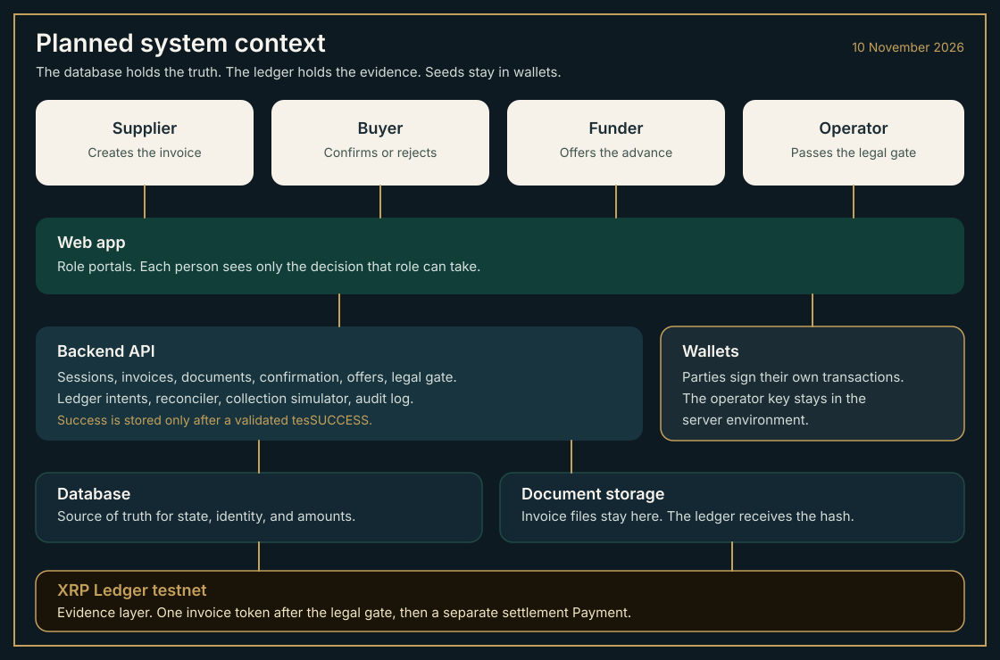

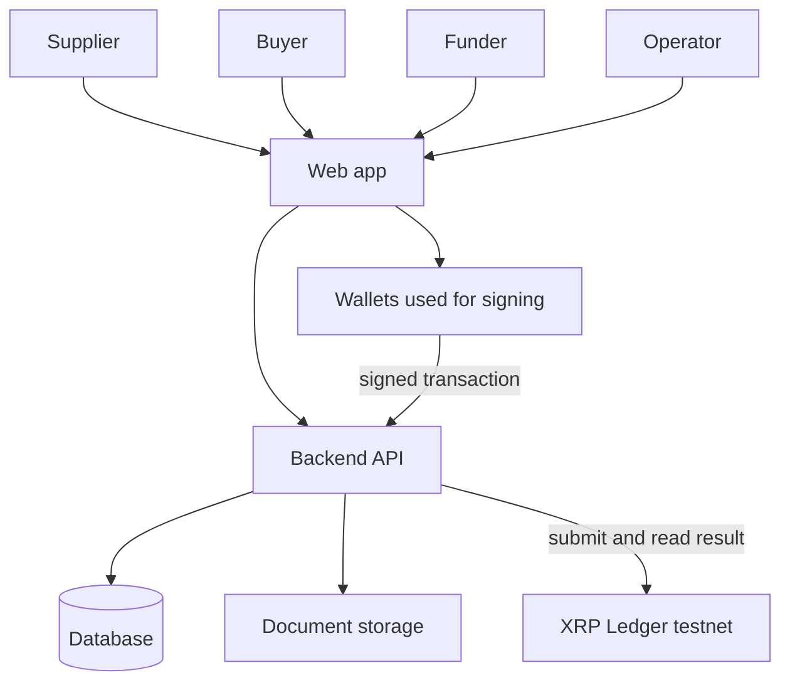

The buyer confirms in the application and does not sign the demo token transactions. The supplier, the funder, and the operator sign the transactions named in [Sequences](#sequences). The wallet signs locally. The signed transaction is posted to the API, which checks it against the stored intent and then submits it. The wallet's own preliminary response is not the success signal.

## Component architecture

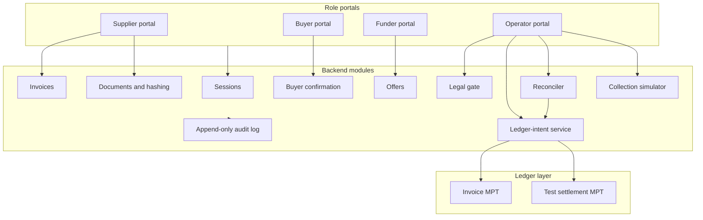

### Frontend

The web app is a set of role portals. The server enforces the role. Hiding a button is only a courtesy.

| Portal | Planned decisions |
| --- | --- |
| Supplier | Create a draft, upload the document, submit it, accept or decline an offer, sign the settlement-token opt-in |
| Buyer | Open one confirmation link and confirm or reject |
| Funder | Offer on a confirmed invoice, sign the invoice-token opt-in, sign the settlement Payment, sign the return of the invoice token |
| Operator | Mark the legal gate, prepare ledger intents, submit operator-signed transactions, reconcile, simulate collection, lock or claw back |

Status is written in words. Colour may repeat the word. It is never the only signal. The buyer path is one short link and one decision, so it can be used on a phone. Drafts survive a dropped connection. The reviewer path uses seeded actors and never asks for a seed phrase or an identity document.

| Commercial state | Words on screen |
| --- | --- |
| `draft` | Draft |
| `awaiting_buyer` | Waiting for the buyer |
| `rejected` | Buyer rejected |
| `confirmed` | Buyer confirmed |
| `offered` | Offer ready |
| `accepted` | Offer accepted |
| `legally_bound` | Documents complete |
| `recording` | Writing the ledger record |
| `recorded` | Recorded, waiting for the advance |
| `advanced` | Advance sent |
| `needs_reconcile` | Needs the operator |
| `disputed` | In dispute |
| `collecting` | Waiting for collection |
| `settled` | Settled |
| `defaulted` | Buyer did not pay |
| `cancelled` | Cancelled |

The operator portal also shows `ledger_status`, the transaction hash, and the reconcile reason. Those details stay off the supplier, buyer, and funder screens except for a link to the public hash once it exists.

### Backend modules

| Module | Responsibility |
| --- | --- |
| Sessions | Opens a demo session for a seeded actor. The role comes from the actor row on the server. |
| Invoices | Creates the commercial record, stores amounts as integer strings, and moves the state machine. |
| Documents and hashing | Stores the file bytes outside the ledger and computes SHA-256 over the exact stored bytes. |
| Buyer confirmation | Issues one buyer-bound link, accepts one decision, and expires the link. |
| Offers | Holds a single reservation on a confirmed invoice and stores the offer in basis points. |
| Legal gate | Stores the assignment note, its hash, and the recourse term, then marks the gate complete. |
| Ledger-intent service | Stores the exact ledger action before anyone signs, checks the signed transaction against that intent, submits it, and records the validated result. |
| Reconciler | Owns `needs_reconcile`. It looks up an unknown hash before any retry and chooses retry or unwind. |
| Collection simulator | Records a simulated fiat outcome and the repayment and residual book entries. It does not move fiat. |
| Append-only audit log | Writes one row for every state change, decision, and ledger result. The application does not update or delete those rows. |

### Ledger layer

The ledger layer is the XRP Ledger testnet. It holds two kinds of Multi-Purpose Token, defined in [XRPL token design](#xrpl-token-design). The backend is the only component that submits, and the only component that may mark a ledger result into the database.

## Data model

The planned demo store is one SQLite database. A later corridor can move the same tables to a server database. Amounts are strings of minor units so a client cannot round them. `commercial_status` and `ledger_status` are different columns. The commercial column is the state machine in the next section. The ledger column is the latest evidence for that invoice.

`ledger_status` is one of `none`, `prepared`, `submitted`, `validated`, `failed`, or `unknown`. The authoritative ledger row is the intent. The invoice column is a projection of the latest relevant intent, so a screen can show it without guessing.

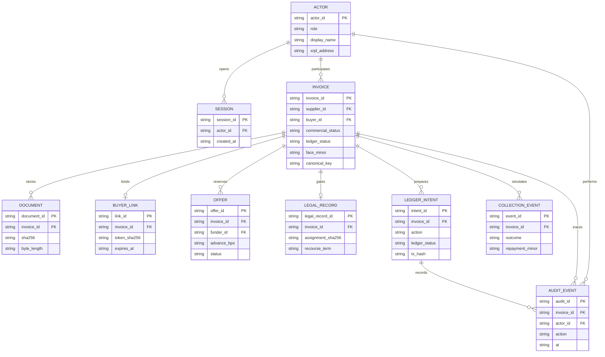

Supporting columns that the diagram omits for space, and that the build still needs:

| Table | Further columns |
| --- | --- |
| Invoice | `invoice_number`, `issue_date`, `due_date`, `currency_code`, `document_sha256`, `issuance_id`, `reconcile_reason`, offer result fields for advance, fee, supplier net, funder repayment, and residual |
| Document | media type, storage key, which actor uploaded it |
| Buyer link | `buyer_id`, `used_at` |
| Offer | `funder_charge_bps`, `platform_fee_bps`, reserved-at |
| Ledger intent | pinned transaction fields, expected signer, engine result, validated ledger index, reconcile reason |
| Collection event | `residual_minor`, `created_at` |
| Audit event | from-state, to-state, intent id, request id |
| Idempotency | actor id, key, request hash, response status, response body |

Integrity rules the database must enforce:

- `canonical_key` is the lowercase hex SHA-256 of the UTF-8 string `buyer_id|supplier_id|invoice_number|YYYY-MM-DD|XTS|face_minor`. The date is the invoice issue date. `face_minor` has no leading zeros. A second invoice with the same key is rejected while any invoice with that key is outside `rejected` and `cancelled`.
- `document_sha256` is the lowercase hex SHA-256 of the exact stored file bytes.
- The assignment-note hash is the SHA-256 of that note's stored bytes, and it is the hash written into token metadata.
- At most one offer on an invoice may be `open` or `accepted`.
- An invoice has at most one issuance id. A second create-issuance intent is rejected once that id exists. After a validated retirement, another mint of that issuance is refused.

`reconcile_reason`, when set, is `issuance_incomplete`, `settlement_failed`, `retirement_pending`, or `result_unknown`.

## Invoice state machine

`ledger_status` is not a node in this machine. A validated ledger result is what allows some of these arrows. It is not itself a commercial state.

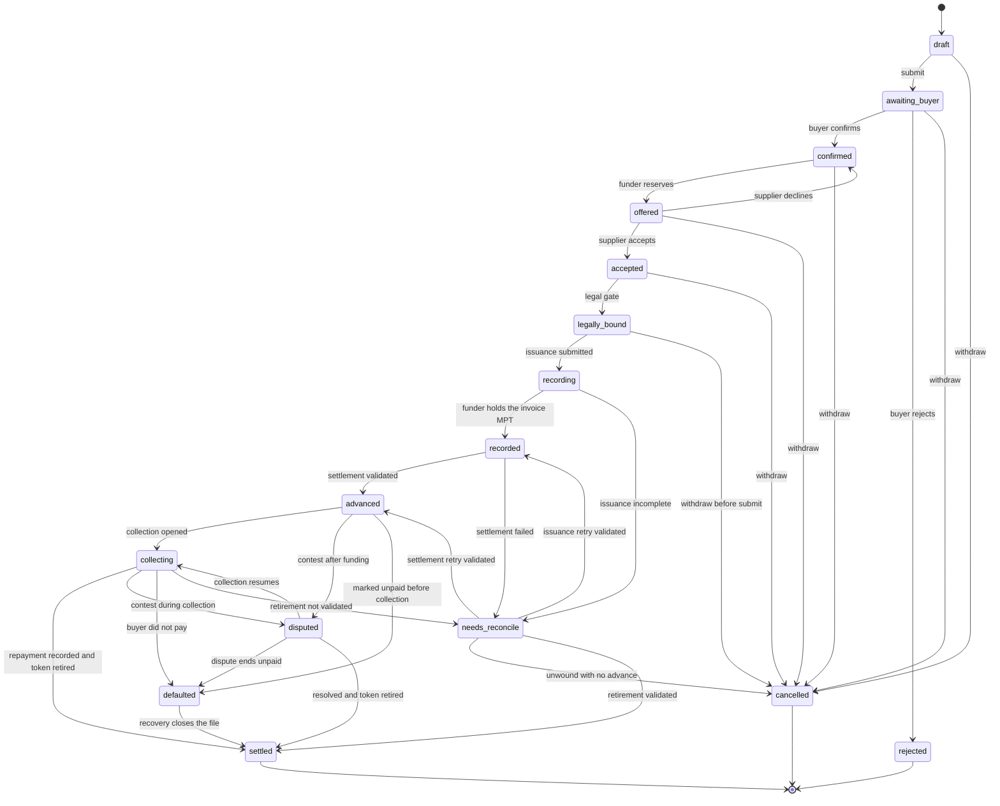

The legal gate is `legally_bound`. Nothing is submitted to the ledger before that state. `recording` starts when the invoice issuance is submitted and continues until the funder holds that token. A local reject of the create, with no issuance id stored, returns the invoice to `legally_bound`. `recorded` means the funder holds the invoice token. `advanced` means the settlement Payment has validated. The application does not skip from `recording` to `advanced`.

`needs_reconcile` is the state for a partial or unknown ledger result. The reconciler leaves on the arrow that matches the reason. An unfinished issuance can reach `recorded`. A failed settlement can reach `advanced` only after the settlement Payment validates. A failed retirement can reach `settled` only after the burn or clawback validates. An unfinished issuance never jumps to `advanced`.

Typical entries:

- Issuance was created, and the Payment that mints the invoice token to the funder has not validated. The invoice is not `recorded`.
- The funder holds the invoice token, and the settlement Payment has not validated. The invoice is not `advanced`.
- Simulated collection was recorded, and the token has not been retired. The invoice is not `settled`.
- A submission timed out. `ledger_status` is `unknown` until a lookup shows whether the hash is in a validated ledger.

`cancelled` after any ledger object exists is an unwind: the invoice token is back with the issuer, which burns it, and no advance was paid. `rejected` is only the buyer's refusal, before any offer is funded.

`disputed` and `defaulted` can lock the funder's invoice-token balance. Recovery stays off the ledger. The demo does not infer recourse from the token. The legal record stores the term.

## XRPL token design

Thursday's first build task is to confirm, on the testnet the demo will use, that `MPTokensV1` is enabled and that the transactions below are accepted. Documentation read on 10 November 2026 describes issuance and direct Payment as enabled, and describes MPT trading on the built-in exchange as not implemented. The demo does not depend on `DynamicMPT`, `TokenEscrow`, confidential transfer, or a permissioned domain. Flag and metadata changes after issuance were still tied to `DynamicMPT`, which was open for voting in that documentation. The demo sets every flag at creation and omits `ImmutableFlags`.

### Invoice token

One issuance per financed invoice, created with `MPTokenIssuanceCreate` only after `legally_bound`.

| Flag | Value | Invoice token |
| --- | --- | --- |
| `tfMPTCanLock` | 2 | On. The operator can lock the funder's balance during a dispute. |
| `tfMPTRequireAuth` | 4 | On. A holder opts in, and the issuer must authorize that holder. |
| `tfMPTCanEscrow` | 8 | Off. |
| `tfMPTCanTrade` | 16 | Off. |
| `tfMPTCanTransfer` | 32 | Off. The holder can send the token only back to the issuer. |
| `tfMPTCanClawback` | 64 | On. The issuer can pull the balance back if the holder cannot sign. |

The Flags value is `2 + 4 + 64 = 70`. `TransferFee` is omitted or zero. A non-zero transfer fee on a non-transferable token is rejected by the ledger. `AssetScale` is 2. `MaximumAmount` is the face amount in minor units, so circulation cannot exceed that invoice. The quantity issued is that same face amount.

The issuer cannot hold its own tokens. The issuance is created empty of holder balances. The operator mints by a `Payment` of the face amount to the funder, after both authorization steps. A `Payment` back to the issuer burns the tokens. That burn is the normal retirement. `Clawback` is the retirement used when the funder cannot sign the return.

A dispute lock is `MPTokenIssuanceSet` from the issuer, with the funder's address in `Holder` and `tfMPTLock` (1). While locked, the holder can still send the balance back to the issuer. Thursday's testnet check includes one retirement of a locked balance, and the demo uses the path that check confirms.

### Settlement token

The settlement asset is a second Multi-Purpose Token, issued once by the operator for the whole demo and labelled as a test stand-in. It is not RLUSD, and it does not represent reserves or a redemption claim.

| Flag | Value | Settlement token |
| --- | --- | --- |
| `tfMPTRequireAuth` | 4 | On. |
| `tfMPTCanTransfer` | 32 | On, so an authorized funder can pay an authorized supplier. |

The Flags value is `4 + 32 = 36`. `AssetScale` is 2. The operator mints a demo pool to the funder by `Payment`, because the issuer cannot hold the tokens. The funder later pays the supplier in a separate `Payment`. Can Lock and Can Clawback stay off. The invoice token remains the instrument that can be locked or clawed back.

The settlement Payment is not atomic with the invoice-token Payment. If the invoice token is in place and the settlement Payment is not validated, the invoice enters `needs_reconcile` and does not enter `advanced`.

### Metadata

`MPTokenMetadata` is hex-encoded JSON. The protocol limit is 1024 bytes of metadata. In the transaction JSON the value is hex, so the decoded UTF-8 JSON is what must be 1024 bytes or fewer. The intent service measures the JSON before encoding and refuses a larger payload. Thursday's check confirms that boundary on the chosen testnet before any edge case is demonstrated.

The JSON uses the short XLS-89 keys so an explorer can label the token. The only invoice-specific values are an opaque reference and the assignment-note SHA-256. Names, invoice numbers, addresses, bank details, and file bytes stay off the ledger. The same display ticker may be reused across invoice issuances. The 192-bit issuance id is the identity, not the ticker.

```json
{
  "t": "TNINV",
  "n": "TradeNote invoice record",
  "d": "Off-ledger receivable. Opaque reference and document hash only.",
  "i": "tradenote.example/mark",
  "ac": "rwa",
  "as": "private_credit",
  "in": "Corridor operator",
  "ai": {
    "ref": "inv_opaque_id",
    "sha256": "lowercase-hex-sha256-of-the-assignment-note"
  }
}
```

The settlement token uses a different ticker, planned as `TNSET`, the asset class `other`, and no invoice hash. Its metadata must not read as a stablecoin or as RLUSD.

### What the intent pins

Each intent stores the semantic transaction before it is signed. At submit time, fee, sequence, last-ledger sequence, and the signature may differ. The pinned fields may not.

| Action | Signer | Pinned fields |
| --- | --- | --- |
| `MPTokenIssuanceCreate` for the invoice | Operator | Flags 70, AssetScale 2, MaximumAmount equal to `face_minor`, metadata hex, no `ImmutableFlags`, no transfer fee |
| `MPTokenAuthorize` opt-in | Funder, and the supplier for the settlement token | Issuance id, holder account equal to the signer |
| `MPTokenAuthorize` allow-list | Operator | Issuance id and the holder account |
| `Payment` minting the invoice token | Operator | Destination funder, exact face amount, issuance id, partial payment unset |
| `Payment` of the settlement token | Funder | Destination supplier, exact supplier-net amount, settlement issuance id, partial payment unset |
| `Payment` returning the invoice token | Funder | Destination issuer, exact outstanding amount |
| `Clawback` | Operator | Holder funder, exact outstanding amount, issuance id |
| `MPTokenIssuanceSet` lock or unlock | Operator | Holder funder, lock or unlock flag, issuance id |

The signed transaction is rejected with `409 INTENT_MISMATCH` if a pinned field differs, if partial payment is set, or if `ImmutableFlags` is present. The expected signer is the `Account` field. The API then submits the blob itself.

A result counts as success only when that submitted transaction is in a validated ledger and the engine result is `tesSUCCESS`. A `tec` code is a failure that the ledger recorded. A local `tel`, `tem`, `tef`, or `ter` code is a failure that was not validated. A timeout sets `ledger_status` to `unknown` and `reconcile_reason` to `result_unknown`. The reconciler looks the hash up, or confirms the account sequence did not consume that transaction, before anything is signed again.

## Sequences

### Upload through buyer confirmation

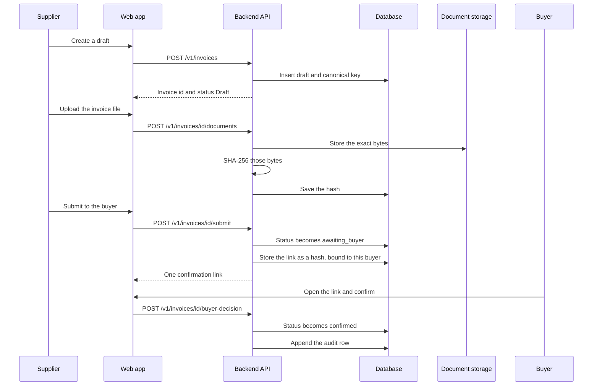

A rejection takes the same route and sets `rejected`. The link is single-use. A second decision, a different buyer, or an expired link returns `409 LINK_INVALID`. No ledger transaction is created in this sequence.

### Offer, acceptance, and the legal gate

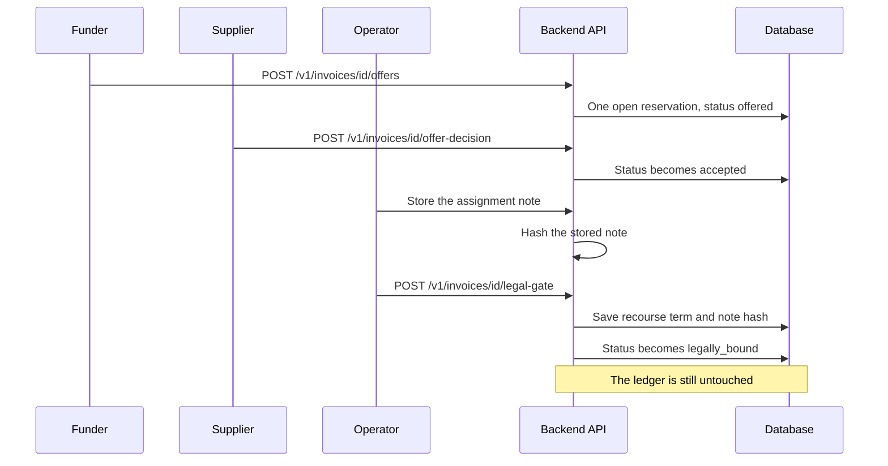

A decline releases the reservation and returns the invoice to `confirmed`. A second funder, while the reservation is open, receives `409 RESERVATION_HELD`. In the demo, the operator attestation means the note is stored and hashed. A later corridor replaces that step with the corridor's own signing process. The screen copy keeps the limit: the token records the documents. It does not replace them.

### Issuance, authorization, and delivery to the funder

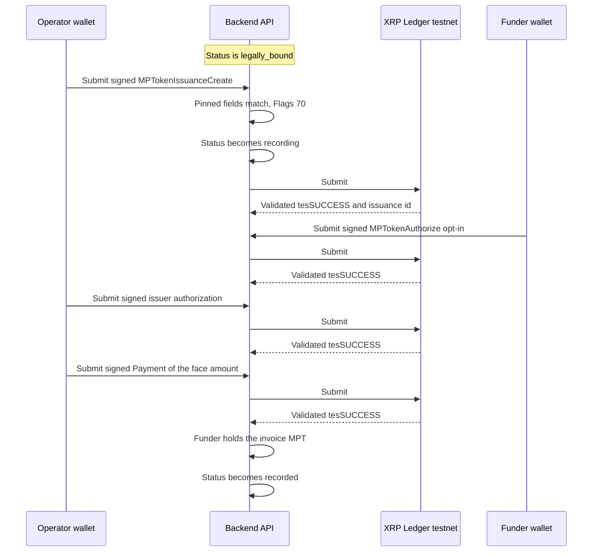

The first successful submit moves the invoice from `legally_bound` to `recording`. It stays in `recording` until the mint Payment validates. The Payment mints the tokens to the funder. It is not a holder-to-holder transfer, and Can Transfer stays off.

### Funding payment

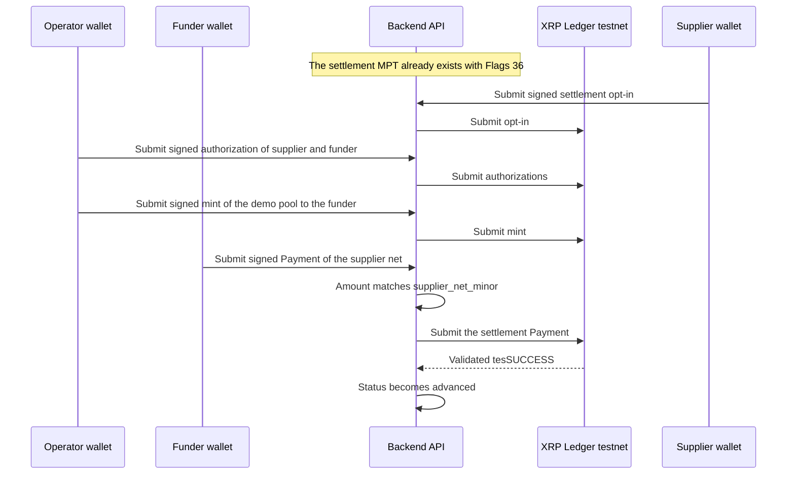

This Payment is a different issuance from the invoice token. The demo may pre-authorize the seeded settlement accounts so the walkthrough is not spent on setup, and those setup transactions remain real testnet transactions with stored hashes. The amount on the funding Payment is the supplier net from [Money handling](#money-handling), not the face and not the gross advance.

### Simulated collection, repayment, residual, and retirement

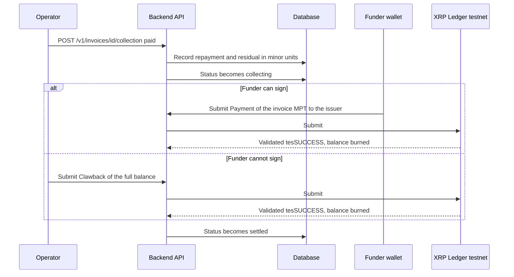

The repayment and the residual are book entries in the database. They simulate the later fiat rails. They are not testnet payments. The invoice reaches `settled` only after those entries exist and the retirement transaction has validated. A failed retirement leaves `needs_reconcile` with reason `retirement_pending`.

On `disputed` or `defaulted`, the operator may lock the funder's balance. The token stays with the funder until the file is actually closed. Default does not burn the record by itself.

### Partial failure into needs_reconcile

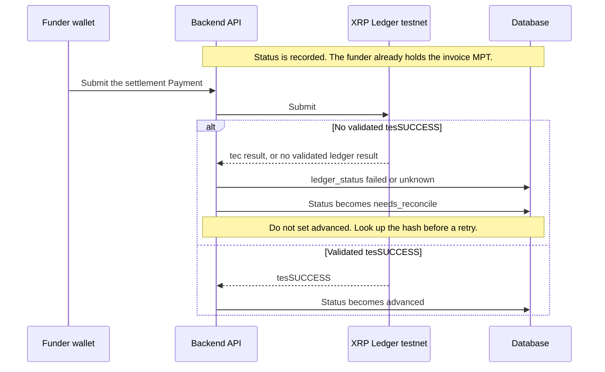

The same door is used earlier in the flow. If `MPTokenIssuanceCreate` validates and the mint Payment does not, the status moves from `recording` to `needs_reconcile` with reason `issuance_incomplete`, and it is not marked `recorded`. A retry submits the unfinished intent. An unwind, available only when no settlement was paid, returns or claws back any balance and then sets `cancelled`.

## API surface

The demo API is JSON under `/v1`. Every invoice body carries `commercial_status` and `ledger_status`. Amounts are strings of minor units. Every `POST` requires an `Idempotency-Key` header. The same key and the same body return the original response. The same key with a different body returns `409 IDEMPOTENCY_CONFLICT`. A missing key returns `400`.

A client-supplied role is ignored. The session's actor row decides what the caller may do. A missing session is `401`. The wrong role is `403`. An unknown id is `404`.

| Method | Path | Who | Planned effect | Conflict |
| --- | --- | --- | --- | --- |
| `POST` | `/v1/sessions` | Seeded actor | Opens a session for that actor | `409 IDEMPOTENCY_CONFLICT` |
| `POST` | `/v1/invoices` | Supplier | Creates a `draft` | `409 DUPLICATE_INVOICE` |
| `GET` | `/v1/invoices` | Session role | Lists invoices that role may see | |
| `GET` | `/v1/invoices/{id}` | Allowed role | Reads one invoice, both status columns, and stored hashes | |
| `POST` | `/v1/invoices/{id}/documents` | Supplier | Stores bytes and SHA-256 | `409 STATE_CONFLICT` |
| `POST` | `/v1/invoices/{id}/submit` | Supplier | `draft` to `awaiting_buyer`, creates the buyer link | `409 STATE_CONFLICT`, `409 DUPLICATE_INVOICE` |
| `POST` | `/v1/invoices/{id}/buyer-decision` | Named buyer | `confirmed` or `rejected` | `409 LINK_INVALID` |
| `POST` | `/v1/invoices/{id}/offers` | Funder | `offered`, one reservation | `409 RESERVATION_HELD`, `409 STATE_CONFLICT` |
| `POST` | `/v1/invoices/{id}/offer-decision` | Supplier | `accepted`, or back to `confirmed` | `409 STATE_CONFLICT` |
| `POST` | `/v1/invoices/{id}/legal-gate` | Operator | `legally_bound`, stores the note hash and recourse term | `409 STATE_CONFLICT` |
| `POST` | `/v1/invoices/{id}/ledger-intents` | Signing role or operator | Stores an intent. Status stays put. `ledger_status` becomes `prepared` | `409 STATE_CONFLICT` |
| `POST` | `/v1/ledger-intents/{id}/submit` | Expected signer, through the API | Checks the signed blob, submits it, stores the hash | `409 INTENT_MISMATCH` |
| `POST` | `/v1/invoices/{id}/reconcile` | Operator | Retries or unwinds from `needs_reconcile` | `409 STATE_CONFLICT` |
| `POST` | `/v1/invoices/{id}/collection` | Operator | Simulated `paid`, `disputed`, or `defaulted` | `409 STATE_CONFLICT` |
| `POST` | `/v1/invoices/{id}/cancel` | Supplier or operator | Withdraws before a recorded advance, or asks for an unwind | `409 STATE_CONFLICT` |

`GET /v1/invoices/{id}` includes the intent list for the operator and the signing portals: action, ledger status, hash, and engine result. Error bodies use one shape.

```json
{
  "error": {
    "code": "RESERVATION_HELD",
    "message": "Another offer already holds this invoice."
  }
}
```

`cancel` is the route that makes `cancelled` reachable. It is not a ledger write when no token exists.

## Security, privacy, and integrity

| Control | Planned behaviour |
| --- | --- |
| Role checks | Every route checks the session's server-side role. The buyer portal cannot offer, and the funder portal cannot mark the legal gate. |
| Buyer-bound link | The raw token is random, shown once, and stored only as a SHA-256. The row binds invoice id and buyer id. It expires after 72 hours in the demo, and it accepts one decision. |
| Document hash | SHA-256 of the exact stored bytes. The hash is recomputed when an operator exports the audit packet. |
| Duplicate financing | The canonical key blocks a second financing inside TradeNote. A bank or another platform is outside that view. The screen does not claim otherwise. |
| Signed-transaction check | Submit compares the signed transaction with the stored intent, then submits the same blob. |
| Validated success | `recorded`, `advanced`, and `settled` wait for `tesSUCCESS` on a validated ledger and a stored hash. |
| Audit trail | Each transition appends actor, action, request id, from-state, to-state, intent id, hash, and engine result. |
| Secrets | Seeds, private keys, and wallet passwords are rejected if they appear in a body. Logs store hashes and results, not file bytes and not seeds. The operator key is read from the environment on the operator host. |
| Demo identities | Seeded actors are pre-approved for the walkthrough. A later corridor uses the operator's identity checks before a funder can offer. |

Personal and commercial documents stay in document storage. The ledger receives the opaque reference, the assignment-note hash, the asset classification, and the token quantity. The quantity is visible to anyone who can read the testnet. That is an accepted property of a public evidence record. Names are not part of that trade.

The internal canonical key is not a cross-platform registry. Supplier warranty, notice to the buyer, and any local receivables registry remain off-ledger legal work.

## Money handling

The demo currency is `XTS`, the ISO 4217 code reserved for testing. `AssetScale` is 2, so one display unit is 100 minor units. `10,000.00` XTS is the string `1000000`. The API accepts that integer string and rejects a decimal or a float.

Every fee uses truncating integer arithmetic:

```text
minor = face_minor * bps / 10000
```

The multiplication happens before the division. Both are integers. For the illustration below, each division is exact, so truncation does not change the result.

The offer carries `advance_bps` and `funder_charge_bps`. The operator's demo schedule carries `platform_fee_bps`. An offer that leaves the supplier with a zero or negative net is rejected.

The figures below are illustrative. They are not a price list, a quote, or a promise of yield.

| Item | Display XTS | Minor units | How it is produced |
| --- | --- | --- | --- |
| Face | 10,000.00 | `1000000` | The confirmed invoice |
| Advance, 80% of face | 8,000.00 | `800000` | `1000000 * 8000 / 10000` |
| Platform fee, 1% of face | 100.00 | `10000` | `1000000 * 100 / 10000` |
| Supplier net | 7,900.00 | `790000` | Advance minus platform fee |
| Funder charge, 2% of face | 200.00 | `20000` | `1000000 * 200 / 10000` |
| Funder repayment | 8,200.00 | `820000` | Advance plus funder charge |
| Buyer pays at collection | 10,000.00 | `1000000` | The face, simulated |
| Supplier residual | 1,800.00 | `180000` | Face minus funder repayment |
| Supplier over the whole file | 9,700.00 | `970000` | Supplier net plus residual |

On the ledger, the invoice token's amount is the face, `1000000`, because the token records the receivable. The settlement Payment is the supplier net, `790000`. The platform fee is a book entry in the same funding record, not a third testnet payment. At simulated collection the database records the buyer paying `1000000`, the funder receiving `820000`, and the supplier residual of `180000`. Those three collection numbers are not ledger payments in this demo.

XRP testnet reserves and transaction fees are paid by the account that submits. They are outside the invoice arithmetic. The operator account needs enough testnet XRP for the issuance reserve and the fees.

If the buyer never pays, the contract term decides the loss. In a non-recourse illustration the funder bears the buyer's credit. In a recourse illustration the supplier may have to repay the advance. The seeded walkthrough stores a labelled non-recourse illustration. A real corridor chooses the term with counsel. Neither outcome is a guaranteed recovery.

## Deployment and observability

The planned demo is one host. It is not a highly available deployment, and this document does not claim the host exists yet.

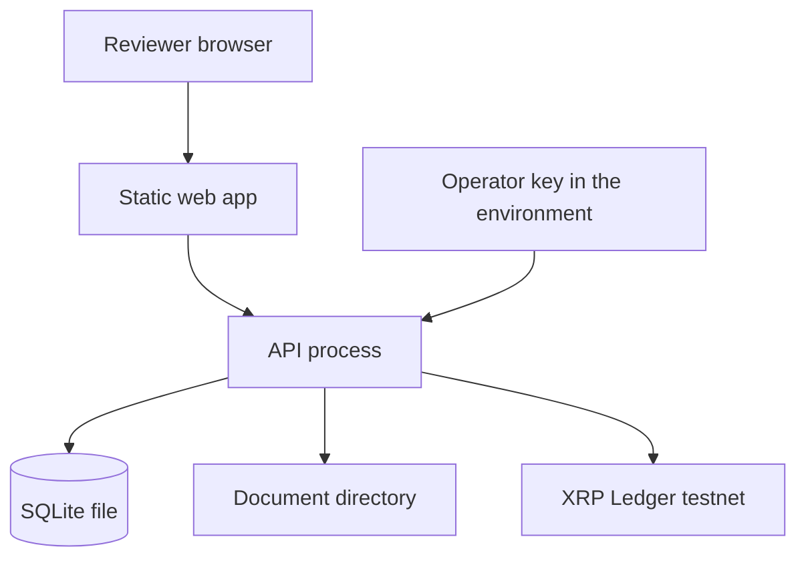

| Piece | Planned demo form |
| --- | --- |
| Web app | Static files served beside the API |
| API | One process |
| Database | One SQLite file, the source of truth |
| Documents | One directory on the same host, outside the database except for the hash, length, media type, and storage key |
| Ledger | XRP Ledger testnet only |
| Operator key | Environment variable or a file outside the repository, read by the API process |
| Party keys | In the signer's wallet. Absent from the host |

Logs are structured and include a request id, the invoice id, the intent id, the transaction hash, and the engine result. They exclude seeds, document bytes, raw confirmation tokens, and assignment-note bodies. The audit table is the record a reviewer can export. The operator portal lists every invoice in `needs_reconcile` with its reason and last hash.

The walkthrough targets, once the demo exists, are the ones in the white paper: a buyer can finish confirm or reject, the gap from `legally_bound` to `recorded` is visible, settlement failures appear in the reconcile queue, and the canonical key rejects a second financing inside the app. Those are targets. They are not measured results.

## Scale and the corridor model

The product language is pan-African. The operating model is one licensed corridor at a time. Currency, contract pack, identity checks, and payout rails are adapters around the same invoice machine and the same ledger rules. The first real launch waits on counsel for assignment, notice, factoring or lending treatment, payments licensing, and virtual-asset rules. The demo uses `XTS` and a collection simulator so it can be judged without pretending that counsel, that licence, or that rail already exists.

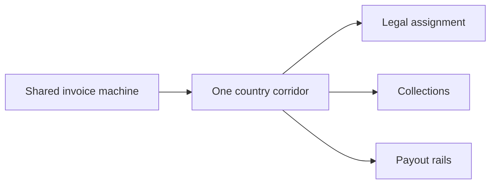

A country partner, when one is later appointed, would hold the corridor permissions, issue the tokens, run the identity checks, and coordinate collection and supplier payouts. No such partner is appointed here. Naming a mobile-money network or a payment processor as a possible future adapter does not create an integration.

A later stablecoin path would replace the test settlement token with a regulated settlement asset, preferably in the invoice currency. If the funding currency and the invoice currency differ, the offer carries an explicit foreign-exchange term or a wider haircut. That change keeps the legal gate, the one invoice token, and the rule that the two payments are sequential. The demo does not take that path and does not use RLUSD.

Nothing in the scale path adds a TradeNote platform token, a public marketplace, or open lending.

## Team ownership

These are build responsibilities. They are not a claim that the work is already done.

| Area | Owner |
| --- | --- |
| Token flags, metadata, transaction sequence, intent pinning, testnet checks, lock, clawback, and burn | Zakariyah Abdulaleem ([@zakkycrypt01](https://github.com/zakkycrypt01)), Blockchain Lead |
| Role portals, status language, confirmation-link screen, low-bandwidth layout, wallet handoff without seeds | Kayode ([@kayode96-max](https://github.com/kayode96-max)), UI/UX and Frontend Lead |
| API, SQLite schema, documents, state machine, idempotency, audit log, reconciler, collection simulator | Abdushakur Bashir ([@abdushakurob](https://github.com/abdushakurob)), Backend Developer |

Shared edges:

| Edge | Split |
| --- | --- |
| Ledger intent | The Blockchain Lead defines the pinned fields and the acceptance rules. The Backend Developer stores them and refuses a mismatch. The Frontend Lead shows the action the signer is about to approve. |
| State copy | The Backend Developer is the only writer of `commercial_status`. The Frontend Lead renders the word table and does not invent a state. |
| Hashes | The Backend Developer computes SHA-256. The Blockchain Lead places the assignment-note hash into metadata. The Frontend Lead shows the hash before a buyer confirms. |
| Reviewer script | All three. One invoice, two explorer hashes, and one forced `needs_reconcile`. |

## Build-day plan and open decisions

The hackathon build window is Thursday 12 and Friday 13 November 2026. The order below is the plan for that window. It is not a statement that any of it has been built.

### Thursday 12 November

1. On the chosen testnet, confirm `MPTokensV1` and a successful create, authorize, mint, lock, clawback, and burn. Confirm the demo does not need `DynamicMPT` or an escrow swap.
2. Fund the operator, funder, and supplier test accounts. Create the settlement token once, with Flags 36 and ticker `TNSET`.
3. Open the database, the session route, invoice create, document storage, the canonical key, and buyer confirm or reject.
4. Show the supplier and buyer portals for that path, with status in words.

### Friday 13 November

1. Add the offer reservation, acceptance, and the legal gate.
2. Add ledger intents, the signed-transaction check, issuance, both authorizations, and the mint Payment to the funder.
3. Add the settlement Payment for the supplier net.
4. Force a failed settlement and show `needs_reconcile` instead of `advanced`.
5. Add the collection simulator, the illustrative residual entries, and retirement by return Payment or clawback.
6. Walk a seeded invoice from upload to two explorer hashes, then to `settled`.

The demo leaves out mainnet value, RLUSD, fiat rails, a live identity vendor, MPT trading, escrow as a substitute for payment, confidential transfer, and any prompt that asks for a seed.

### Open decisions

| Decision | Planned demo default | Still open for a real corridor |
| --- | --- | --- |
| First country | None. The demo is not a corridor launch | Counsel chooses after assignment, licensing, and virtual-asset review |
| Recourse | The seeded file stores a labelled non-recourse illustration | The corridor contract chooses |
| Who may legally issue and collect | The operator role in the demo | Counsel and the local partner |
| Securities or lending treatment | No public trading and no platform token | Local counsel |
| Buyer-link lifetime | 72 hours, single use | Operator policy |
| Party signing in the walkthrough | A wallet the signer controls. A labelled demo signer is allowed only if its seed stays out of the repo, the UI, and the logs | Production custody and multi-sign for the issuer |
| Settlement ticker | `TNSET` | Must not be mistakable for a real stablecoin |
| File cap | One PDF or image, up to 8 MB | Corridor document rules |
| Database host | SQLite on the demo host | A server database when a corridor needs one |

Amendment status is also an open check, by design. The Thursday testnet query outranks this document if the network disagrees with it.

## Sources

Public documents used for the ledger rules, read on 10 November 2026. Feature status can change. The Thursday testnet check is the one the build follows.

- Multi-Purpose Tokens, including flags, metadata, and the note that an issuer cannot hold its own tokens: https://xrpl.org/docs/concepts/tokens/fungible-tokens/multi-purpose-tokens
- `MPTokenIssuanceCreate` flag values and the 1024-byte metadata field: https://xrpl.org/docs/references/protocol/transactions/types/mptokenissuancecreate
- `MPTokenIssuanceSet` lock and unlock, including `tfMPTLock`: https://xrpl.org/docs/references/protocol/transactions/types/mptokenissuanceset
- XLS-89 short metadata keys, including `ac` of `rwa` and `as` of `private_credit`: https://xls.xrpl.org/xls/XLS-0089-multi-purpose-token-metadata-schema.html
- ISO 4217 test code `XTS`, used here as the demo currency code.

See also the [white paper](../WHITEPAPER.md) and the [README](../README.md).
